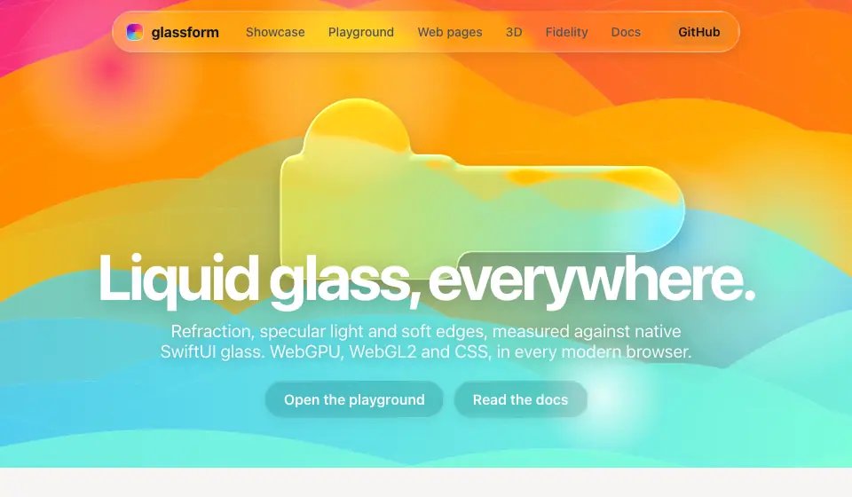
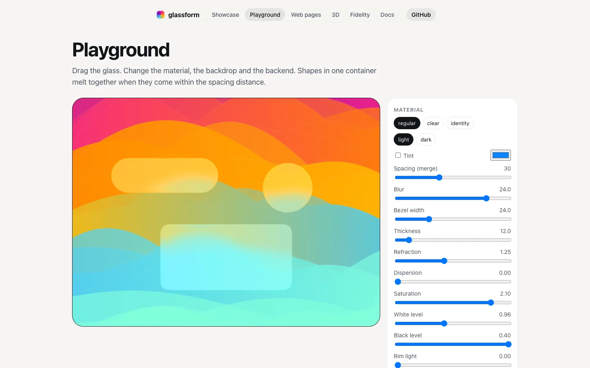

<div align="center">

# glassform

Liquid glass for the web, in every browser.

[Live site](https://gitguy268.github.io/glassform/) · [Playground](https://gitguy268.github.io/glassform/#/playground) · [Docs](https://gitguy268.github.io/glassform/#/docs) · [Fidelity](#how-close-to-native) · [Install](#install)

[](https://github.com/Gitguy268/glassform/actions/workflows/ci.yml)
[](LICENSE)




</div>

glassform renders Apple-style liquid glass on the web: a lens that bends what is behind it toward the rim, a bright edge facing the light, a soft one facing away, a gentle lift of the colours underneath, and shapes that melt together when they come close. It runs on WebGPU where the browser has an adapter, on WebGL2 everywhere else, and as plain CSS over ordinary pages.

I built it on [liquid-dom](https://github.com/AndrewPrifer/liquid-dom) by Andras Prifer, which is WebGPU-only and needs a Chrome flag for DOM content. glassform adds the WebGL2 backend, works with the HTML-in-Canvas API that now ships in Chromium, adds fallbacks for Firefox and Safari, SwiftUI-style materials, a CSS tier, and a harness that measures the result against native SwiftUI glass.

## What runs where

| Browser | Renderer | Live HTML behind GPU glass | CSS tier refraction |
| --- | --- | --- | --- |
| Chrome, Edge, Brave, Opera 159+ | WebGPU, else WebGL2 | Yes, through HTML-in-Canvas | Yes |
| Safari 26+ | WebGPU, else WebGL2 | Snapshot, or live overlay on top | Blur and colour only |
| Firefox | WebGPU where enabled, else WebGL2 | Snapshot, or live overlay on top | Blur and colour only |

Images, video, canvases and Three.js or React Three Fiber scenes refract in every browser. Backends and content modes are picked by feature detection.

## Packages

| Package | Use it when |
| --- | --- |
| [`@glassform/react`](packages/react) | You write React. `LiquidCanvas` for GPU glass, `GlassSurface` for glass over page content. |
| [`@glassform/css`](packages/css) | Glass over an ordinary page without a framework: `glass(el)` or `<glass-surface>`. |
| [`@glassform/core`](packages/core) | Imperative scene graph, `Renderer` (WebGPU and WebGL2), materials and content sources. |
| [`@glassform/three`](packages/three) | You render a Three.js scene and want glass over it. |
| [`@glassform/r3f`](packages/r3f) | React Three Fiber. |
| [`@glassform/layout`](packages/layout) | SwiftUI-style layout with no renderer attached. |

## Install

The packages are not on npm yet, so build them from this repository. You need Node.js 22+ and pnpm 10.

```sh
git clone https://github.com/Gitguy268/glassform.git
cd glassform
pnpm install
pnpm build
pnpm --filter @glassform/site dev     # the site with every demo, on http://127.0.0.1:5199
```

To use the packages in another project before they are published, add them as `file:` or `link:` dependencies pointing at `packages/<name>`.

## Use

```tsx
import { LiquidCanvas, ZStack, Html, Frame, GlassContainer, Glass, GlassSurface } from '@glassform/react'

// GPU glass over an image, video or canvas: refracts in every browser.
<LiquidCanvas style={{ width: 420, height: 280 }}>
  <ZStack>
    <Html zIndex={-1} sizing="fill" source={coverImage} fit="cover" />
    <GlassContainer material={{ variant: 'regular' }} spacing={24}>
      <Frame width={260} height={64}>
        <Glass cornerRadius={32} onClick={play} />
      </Frame>
    </GlassContainer>
  </ZStack>
</LiquidCanvas>

// Glass over the page itself, no canvas.
<GlassSurface cornerRadius="capsule" interactive>Play</GlassSurface>
```

```js
import { Renderer, Scene, Html, Container, Glass, resolveMaterial } from '@glassform/core'

const scene = new Scene()
scene.add(new Html({ width: 800, height: 600, zIndex: -1, source: video }))
const container = new Container({ ...resolveMaterial({ variant: 'clear' }), x: 120, y: 120 })
container.add(new Glass({ width: 280, height: 96, cornerRadius: 48 }))
scene.add(container)

const renderer = new Renderer({ scene }) // backend: 'auto' | 'webgpu' | 'webgl2'
document.body.append(renderer.canvas)
console.log(await renderer.ready)         // 'webgpu' or 'webgl2'
```

The [docs page](https://gitguy268.github.io/glassform/#/docs) covers every prop, Three.js, React Three Fiber and the CSS tier.



## How close to native

"The same as Apple's glass" is only meaningful as a measurement, so glassform measures it. The [`fidelity/`](fidelity) folder holds:

- a SwiftUI app (`fidelity/native`, Command Line Tools only) that renders 41 fixed scenes with `.glassEffect()` and captures them with ScreenCaptureKit, plus the Core Animation filter values macOS uses for each one;
- `score.mjs`, which renders the same scenes with every backend in Chromium, Firefox and WebKit and scores them inside the glass area with SSIM and CIEDE2000;
- `tune.mjs`, which fits the material presets to the captures.

The starting presets come from the private `glassBackground` filter that `NSGlassEffectView` uses on macOS 27.2.1: blur radius 5, face saturation 1.3, white level 1.125, black level 0.08, a key light at π/2 with a 2π/3 spread, and no chromatic aberration.

<details>
<summary>Current status</summary>

The native captures need macOS Screen Recording permission for the reference app. Until a capture run is published here, the presets are the hand-set starting values above and have not been fitted. The [Fidelity page](https://gitguy268.github.io/glassform/#/fidelity) shows the latest report when there is one.

The WebGL2 and WebGPU backends match each other: on the same scene in Chromium they score SSIM 0.99999999 (mean ΔE2000 0.00003), and a browser test checks this on every run with a WebGPU adapter.

</details>

## Tested

| What | Where | Result |
| --- | --- | --- |
| Unit tests (layout, core, css, react) | Node, vitest | 101 pass |
| Backend selection, forced WebGL2, refraction, content modes, clicks on glass content | Chromium, Chromium with WebGPU, Firefox, WebKit (Playwright 1.65) | pass |
| Three.js WebGLRenderer path, CSS tier | same four | pass |
| WebGL2 vs WebGPU parity | Chromium with WebGPU | pass |
| Site pages load without console errors | Chromium with WebGPU, Firefox, WebKit | pass |

## Not tested

| What | Why |
| --- | --- |
| Native fidelity scores | waiting for Screen Recording permission on the reference app |
| Real Safari and Firefox `backdrop-filter` rendering | Playwright's WebKit and Firefox screenshots leave it out; the CSS tier is checked by computed style there |
| iOS and Android browsers | no devices in the test setup |
| Windows and Linux GPUs | tests ran on an Apple M4 Mac |

<details>
<summary>How it works</summary>

The scene graph and layout come from liquid-dom. For each glass container the renderer draws a displacement field from a fused signed distance field of its shapes, blurs the backdrop at an adaptive resolution, then shades the glass: refraction through a convex bezel, optional dispersion, a face colour matrix, tint, a rim light facing the light direction and its opposite, a key light inside the bezel, and a drop shadow.

The WGSL passes in `packages/core/src/shaders.ts` have GLSL twins in `shaders-glsl.ts`. Storage buffers become RGBA32F data textures, uniform structs become vec4 arrays, and the CPU packing in `shape-packing.ts` feeds both.

Html nodes get their pixels in one of four ways: live DOM through HTML-in-Canvas (`content="drawable"`, `drawElementImageToTexture`), a media source, a DOM snapshot made with modern-screenshot, or a live overlay that sits above the canvas. Content on glass stays real, clickable DOM in every mode.

</details>

<details>
<summary>Project layout</summary>

| Path | What |
| --- | --- |
| `packages/*` | the six libraries |
| `apps/site` | the site: showcase, playground, CSS tier, 3D, fidelity, docs |
| `demo/*` | smaller examples from liquid-dom (minimal, blending, Three.js) |
| `fidelity/` | native reference app, scenes, scorer, tuner |
| `e2e/` | Playwright tests and test pages |
| `scripts/` | generated artwork and README media |

</details>

## Credits

- [liquid-dom](https://github.com/AndrewPrifer/liquid-dom) by Andras Prifer (MIT): the scene graph, WebGPU renderer, layout engine, React, Three.js and R3F packages and the showcase demos.
- [liquid-glass-studio](https://github.com/iyinchao/liquid-glass-studio) by Charles Yin (MIT): ideas for the dual-backend design and the list of effects.
- [liquid-glass](https://github.com/shuding/liquid-glass) by Shu Ding (MIT): the SVG displacement idea behind the CSS tier.

See [NOTICE](NOTICE) for details. Not affiliated with Apple. "Liquid Glass" is Apple's name for its design material.

## License

MIT. See [LICENSE](LICENSE). Contributions are welcome, see [CONTRIBUTING.md](CONTRIBUTING.md).
